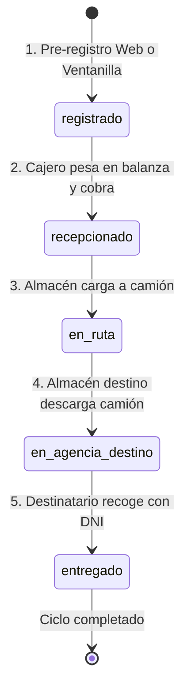

# 📦 Guía Técnica de Exposición 02: Flujo Integral de Envío Agencia a Agencia

Esta guía detalla de manera minuciosa, práctica y pedagógica cómo funciona de principio a fin el flujo operativo y logístico de un **Envío de Encomienda de Agencia a Agencia** (`agencia_agencia`) en **CargaExpress Perú**.

---

## 1. Visión General del Negocio y Quiénes Intervienen

El flujo **Agencia a Agencia** es el núcleo operativo de mayor volumen de la empresa. Conecta dos sedes físicas provinciales o departamentales a través de una cadena de custodia estricta de 5 fases sucesivas.

### 👥 Actores que Intervienen en el Flujo

```text
┌─────────────────┐       ┌─────────────────┐       ┌─────────────────┐       ┌─────────────────┐       ┌─────────────────┐
│   1. CLIENTE    │       │   2. CAJERO     │       │  3. ALMACENERO  │       │  4. ALMACENERO  │       │   5. CAJERO     │
│    REMITENTE    │       │  ORIGEN (Caja)  │       │ ORIGEN (Desp.)  │       │ DESTINO (Arrib) │       │ DESTINO (Entr.) │
│                 │       │                 │       │                 │       │                 │       │                 │
│ Genera la orden │ ────► │ Pesa en balanza │ ────► │ Carga al camión │ ────► │ Descarga camión │ ────► │ Valida DNI del  │
│ (Web o Ventan.) │       │ Cobra y emite CP│       │ y despacha ruta │       │ e ingresa stock │       │ destinatario y  │
│ Estado:         │       │ Estado:         │       │ Estado:         │       │ Estado:         │       │ entrega bulto   │
│ 'registrado'    │       │ 'recepcionado'  │       │ 'en_ruta'       │       │ 'en_agencia_    │       │ Estado:         │
│                 │       │                 │       │                 │       │  destino'       │       │ 'entregado'     │
└─────────────────┘       └─────────────────┘       └─────────────────┘       └─────────────────┘       └─────────────────┘
```

1. **Cliente Remitente:** Registra la orden de envío (pre-registro web o directo en ventanilla).
2. **Cajero en Agencia Origen:** Verifica el bulto físico, realiza pesaje real en balanza, ajusta precio si hay sobrecubicaje, cobra y emite comprobante (Boleta o Factura).
3. **Almacenero / Despachador en Sede Origen:** Consolida los paquetes en bodega y los carga en el camión interprovincial, marcando el despacho a ruta.
4. **Almacenero en Sede Destino:** Recibe el camión, realiza la descarga y verifica la integridad del bulto, ingresándolo a custodia de la agencia destino.
5. **Cajero en Agencia Destino:** Atiende al destinatario en ventanilla, exige el DNI físico obligatorio para validar identidad, cobra si era contraentrega y entrega el paquete.
6. **Cliente Destinatario:** Recibe su encomienda y firma la constancia de entrega.

---

## 2. Diagrama de Transición de Estados (Máquina de Estados)

La base de datos restringe estrictamente que las encomiendas sigan esta secuencia fija. No se permite saltar pasos (por ejemplo, no se puede entregar un paquete que no ha arribado a la agencia destino):



---

## 3. Flujo Paso a Paso Detallado (Frontend ⇄ Backend ⇄ Base de Datos)

### 🟡 Fase 1: Creación del Pedido (`estado = registrado`)
* **Dónde ocurre:** Portal Web Público ([RegistrarPedido.jsx](file:///c:/Users/User/Documents/VSC-Integrador/CargaExpressFront/src/pages/public/RegistrarPedido.jsx)) o en Ventanilla.
* **Llamada API:** `POST /api/v1/publico/pedidos/registrar`.
* **Backend:** Ejecuta `PublicoService.registrar_pedido_web()`:
  1. Valida que las agencias de origen y destino existan y estén activas.
  2. Busca o crea a los clientes (`remitente` y `destinatario`) en la tabla `clientes`.
  3. **Cálculo de Cubicaje IATA:**
     $$\text{Peso Volumétrico (kg)} = \frac{\text{Largo (cm)} \times \text{Ancho (cm)} \times \text{Alto (cm)}}{6000}$$
  4. **Cálculo de Tarifa Base:**
     $$\text{Peso Liquidable} = \max(\text{Peso Real}, \text{Peso Volumétrico})$$
     $$\text{Total (S/)} = 8.00 + (\text{Peso Liquidable} \times 2.50)$$
  5. **Desglose Fiscal SUNAT (18% IGV Perú):**
     $$\text{Subtotal} = \text{round}\left(\frac{\text{Total}}{1.18}, 2\right), \quad \text{IGV} = \text{Total} - \text{Subtotal}$$
  6. **Genera Código Correlativo Seguro:** Formato `CE-YYYY-NNNNN` (ejemplo: `CE-2026-00003`).
* **Base de Datos:**
  * Inserta fila en `envios` con `estado = "registrado"`, `estado_pago = "pendiente"`.
  * Inserta hito inicial en `historial_envios`: *"Pre-registro de envío completado vía portal web de autoservicio."*

---

### 🟠 Fase 2: Recepción Física y Pesaje en Ventanilla (`estado = recepcionado`)
* **Quién lo hace:** Rol **Cajero** o **Supervisor** en la Agencia Origen.
* **Dónde ocurre:** Vista [RecepcionEnvios.jsx](file:///c:/Users/User/Documents/VSC-Integrador/CargaExpressFront/src/pages/admin/caja/RecepcionEnvios.jsx).
* **Llamada API:** `POST /api/v1/envios/{codigo_tracking}/recepcionar`.
  * *Payload enviado:* `{ peso_real_kg, largo_real_cm, ancho_real_cm, alto_real_cm, observaciones }`.
* **Backend:** Ejecuta `EnvioService.recepcionar()`:
  1. Verifica que el envío esté en estado `"registrado"`.
  2. Compara el peso y volumen declarados en la web contra las medidas reales de la balanza de ventanilla.
  3. Si las medidas reales superan lo cotizado, recalcula el total y registra el cobro de reintegro en el historial.
  4. Actualiza `forma_pago = "efectivo"` y `estado_pago = "pagado"`.
  5. Actualiza `estado = "recepcionado"` y las dimensiones físicas reales verificadas.
* **Base de Datos:**
  * Actualiza la fila en `envios`.
  * Inserta nuevo hito en `historial_envios`: *"Recepcionado en agencia origen. Peso verificado en balanza: X kg."*

---

### 🔵 Fase 3: Despacho a Ruta Interprovincial (`estado = en_ruta`)
* **Quién lo hace:** Rol **Almacén** o **Supervisor** en la sede origen.
* **Dónde ocurre:** Vista [AlmacenDespacho.jsx](file:///c:/Users/User/Documents/VSC-Integrador/CargaExpressFront/src/pages/admin/almacen/AlmacenDespacho.jsx).
* **Llamada API:** `POST /api/v1/envios/{codigo_tracking}/despachar`.
  * *Payload enviado:* `{ notas: "Camión Volvo Placa ABC-123 Chofer: Juan Perez" }`.
* **Backend:** Ejecuta `EnvioService.despachar()`:
  1. Valida que el paquete esté en estado `"recepcionado"`.
  2. Cambia el estado a `"en_ruta"`.
* **Base de Datos:**
  * Actualiza `envios.estado = "en_ruta"`.
  * Inserta hito en `historial_envios`: *"Despachado y en tránsito hacia la agencia destino. Notas: Camión Volvo..."*

---

### 🟣 Fase 4: Arribo y Descarga en Bodega Destino (`estado = en_agencia_destino`)
* **Quién lo hace:** Rol **Almacén** o **Cajero** en la sede receptora.
* **Dónde ocurre:** Vista [AlmacenArribos.jsx](file:///c:/Users/User/Documents/VSC-Integrador/CargaExpressFront/src/pages/admin/almacen/AlmacenArribos.jsx).
* **Llamada API:** `POST /api/v1/envios/{codigo_tracking}/arribar`.
  * *Payload enviado:* `{ notas: "Bulto recibido conforme en bodega Lima" }`.
* **Backend:** Ejecuta `EnvioService.arribar()`:
  1. Valida que el paquete esté en estado `"en_ruta"`.
  2. Cambia el estado a `"en_agencia_destino"`.
* **Base de Datos:**
  * Actualiza `envios.estado = "en_agencia_destino"`.
  * Inserta hito en `historial_envios`: *"Arribó a la ciudad destino y está bajo custodia de la agencia destino."*
* **Efecto Operativo:** A partir de este momento, el paquete aparece disponible en la lista de entregas para que el destinatario lo retire.

---

### 🟢 Fase 5: Entrega en Ventanilla al Destinatario (`estado = entregado`)
* **Quién lo hace:** Rol **Cajero** en la sede destino.
* **Dónde ocurre:** Vista [EnvioDetalle.jsx](file:///c:/Users/User/Documents/VSC-Integrador/CargaExpressFront/src/pages/admin/envios/EnvioDetalle.jsx) o Ventanilla de Entregas.
* **Llamada API:** `POST /api/v1/envios/{codigo_tracking}/entregar`.
  * *Payload enviado:* `{ nombre_receptor, dni_receptor, parentesco_o_relacion, observaciones }`.
* **Backend:** Ejecuta `EnvioService.entregar()`:
  1. Valida que el estado sea `"en_agencia_destino"`.
  2. Si el pago estaba marcado como contraentrega (`lugar_pago = "destino"`), formaliza el cobro registrándolo como `"pagado"`.
  3. Fija `fecha_entrega_real = datetime.now()`.
  4. Cambia `estado = "entregado"`.
* **Base de Datos:**
  * Actualiza `envios` con la fecha y estado final.
  * Inserta hito de cierre en `historial_envios`: *"Entregado exitosamente a [Nombre Receptor] (DNI/Doc: [DNI]). Condición: Titular / Apoderado."*

---

## 4. Persistencia en Base de Datos: Tablas y Relaciones Específicas

Para explicar la conexión de datos ante el jurado:

```text
┌────────────────────────┐              ┌────────────────────────┐
│     TABLA: agencias    │              │     TABLA: clientes    │
├────────────────────────┤              ├────────────────────────┤
│ id (PK)                │              │ id (PK)                │
│ codigo_agencia         │              │ tipo_documento (dni/ruc│
│ nombre                 │              │ numero_documento       │
│ departamento/prov/dist │              │ nombre_completo        │
└───────────┬────────────┘              └───────────┬────────────┘
            │                                       │
            │ (agencia_origen_id)                   │ (remitente_id)
            │ (agencia_destino_id)                  │ (destinatario_id)
            ▼                                       ▼
┌────────────────────────────────────────────────────────────────┐
│                         TABLA: envios                          │
├────────────────────────────────────────────────────────────────┤
│ id (INTEGER PRIMARY KEY)                                       │
│ codigo_tracking (VARCHAR 20, UNIQUE) -> "CE-2026-00001"        │
│ remitente_id (FK -> clientes.id)                               │
│ destinatario_id (FK -> clientes.id)                            │
│ agencia_origen_id (FK -> agencias.id)                          │
│ agencia_destino_id (FK -> agencias.id)                         │
│ tipo_envio (VARCHAR) -> 'agencia_agencia'                      │
│ peso_kg, largo_cm, ancho_cm, alto_cm, peso_volumetrico         │
│ monto_subtotal (NUMERIC 10,2)                                  │
│ monto_igv (NUMERIC 10,2)                                       │
│ precio_envio (NUMERIC 10,2)                                    │
│ estado_pago ('pendiente', 'pagado')                            │
│ estado ('registrado', 'recepcionado', 'en_ruta',               │
│         'en_agencia_destino', 'entregado')                     │
│ fecha_entrega_real (DATETIME)                                  │
└───────────────────────────────┬────────────────────────────────┘
                                │ 1 : N
                                ▼
┌────────────────────────────────────────────────────────────────┐
│                    TABLA: historial_envios                     │
├────────────────────────────────────────────────────────────────┤
│ id (INTEGER PRIMARY KEY)                                       │
│ envio_id (FK -> envios.id)                                     │
│ estado (VARCHAR 50) -> 'recepcionado', 'en_ruta', etc.         │
│ descripcion (VARCHAR 300) -> Detalle del hito / notas          │
│ ubicacion (VARCHAR 200) -> Agencia o Ruta                      │
│ usuario_id (FK -> usuarios.id) -> Operador responsable         │
│ creado_en (DATETIME) -> Marca temporal exacta del evento       │
└────────────────────────────────────────────────────────────────┘
```

---

## 5. Módulos de Código Exactos para Mostrar en la Exposición

Si te piden abrir el código para sustentar esta funcionalidad:

### Backend:
1. [app/models/envio.py](file:///c:/Users/User/Documents/VSC-Integrador/CargaExpressBackend/app/models/envio.py):
   * Línea 16: Campos de `Envio` (tracking, clientes, agencias, desglose contable, estados).
   * Línea 78: Modelo `HistorialEnvio` para la línea de tiempo inmutable.
2. [app/services/envio_service.py](file:///c:/Users/User/Documents/VSC-Integrador/CargaExpressBackend/app/services/envio_service.py):
   * Línea 9: `recepcionar()` (Recálculo de cubicaje, validación de estado anterior y cobro).
   * Línea 79: `despachar()` (Validación de estado y paso a `"en_ruta"`).
   * Línea 106: `arribar()` (Descarga en sede y paso a `"en_agencia_destino"`).
   * Línea 133: `entregar()` (Validación de DNI físico del receptor y cierre con fecha real).
3. [app/services/publico_service.py](file:///c:/Users/User/Documents/VSC-Integrador/CargaExpressBackend/app/services/publico_service.py):
   * Línea 229: `registrar_pedido_web()` (Cálculo de IGV 18%, generación de correlativo `CE-YYYY-NNNNN`).
4. [app/api/v1/endpoints/envios.py](file:///c:/Users/User/Documents/VSC-Integrador/CargaExpressBackend/app/api/v1/endpoints/envios.py):
   * Línea 195: Endpoint `/{id}/recepcionar` con autorización `require_role(["CAJERO", "ALMACEN"])`.
   * Línea 222: Endpoint `/{id}/despachar` con `require_role(["ALMACEN", "TRANSPORTISTA"])`.
   * Línea 250: Endpoint `/{id}/arribar` con `require_role(["ALMACEN", "CAJERO"])`.
   * Línea 277: Endpoint `/{id}/entregar` con `require_role(["CAJERO", "COURIER"])`.

### Frontend:
1. [src/pages/public/RegistrarPedido.jsx](file:///c:/Users/User/Documents/VSC-Integrador/CargaExpressFront/src/pages/public/RegistrarPedido.jsx): Formulario de cotización y pre-registro.
2. [src/pages/admin/caja/RecepcionEnvios.jsx](file:///c:/Users/User/Documents/VSC-Integrador/CargaExpressFront/src/pages/admin/caja/RecepcionEnvios.jsx): Vista de balanza y recepción del cajero.
3. [src/pages/admin/almacen/AlmacenDespacho.jsx](file:///c:/Users/User/Documents/VSC-Integrador/CargaExpressFront/src/pages/admin/almacen/AlmacenDespacho.jsx): Vista de carga al camión por código de tracking.
4. [src/pages/admin/almacen/AlmacenArribos.jsx](file:///c:/Users/User/Documents/VSC-Integrador/CargaExpressFront/src/pages/admin/almacen/AlmacenArribos.jsx): Vista de descarga de camión en sede destino.
5. [src/pages/admin/envios/EnvioDetalle.jsx](file:///c:/Users/User/Documents/VSC-Integrador/CargaExpressFront/src/pages/admin/envios/EnvioDetalle.jsx): Vista de trazabilidad completa y modal de entrega física con DNI.

---

## 6. Preguntas Típicas del Jurado / Evaluador y Cómo Responderlas

| Pregunta Típica | Respuesta Técnica y de Negocio |
|:---|:---|
| **¿Qué pasa si el cliente registra en la web que su paquete pesa 1 kg pero en ventanilla pesa 10 kg?** | *"En la fase de recepción, el cajero ingresa los datos reales de la balanza. El backend ejecuta la fórmula de cubicaje oficial en servidor, calcula la diferencia tarifaria y actualiza el total, cobrando el reintegro antes de pasar el paquete a 'recepcionado'."* |
| **¿Por qué dividen el peso volumétrico entre 6000?** | *"Es el factor estándar internacional IATA para transporte terrestre y de carga express. Representa la equivalencia entre espacio ocupado en metros cúbicos y peso en kilogramos."* |
| **¿Cómo garantizan que un paquete no se marque como 'entregado' por error si aún está en viaje?** | *"La lógica de negocio en `EnvioService.entregar()` exige como precondición matemática que `envio.estado == 'en_agencia_destino'`. Si un usuario intenta marcar entrega en cualquier otro estado, el servidor arroja una excepción `ValueError` y HTTP 400."* |
| **¿Cómo sabe el cliente dónde está su paquete?** | *"A través de la tabla `historial_envios`. Cada vez que un operario recepciona, despacha, arriba o entrega el paquete, se genera un registro inmutable con fecha, estado y descripción que se expone en la vista pública de `/tracking/:codigo`."* |
