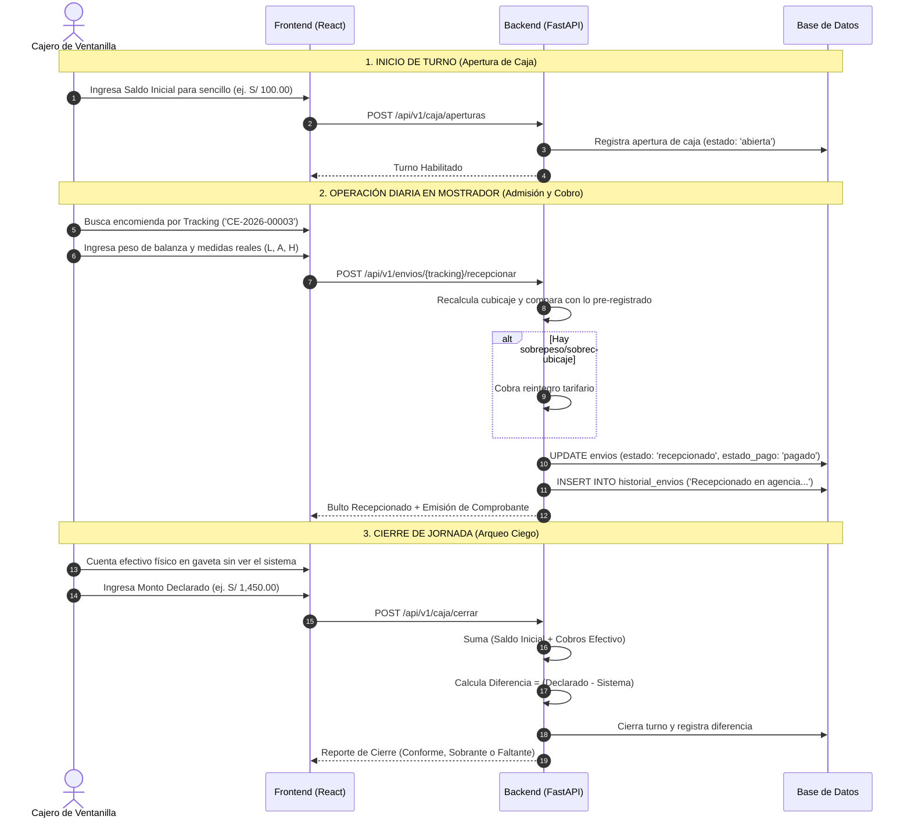

# 💵 Guía Técnica de Exposición 03: Caja, Recepción en Mostrador y Arqueo Ciego

Esta guía detalla de manera minuciosa, práctica y técnica cómo opera el módulo de **Caja, Admisión en Mostrador y Control de Efectivo** en **CargaExpress Perú**.

---

## 1. Visión General del Negocio y Propósito Financiero

La ventanilla de caja es el punto neurálgico de **recaudación y custodia de dinero físico y digital** de la empresa. Para evitar pérdidas por descuadres, jineteo de fondos o cobros no declarados, el sistema implementa tres pilares contables:

1. **Inspección Física y Recálculo en Balanza:** Ajuste automático del flete si las dimensiones reales superan lo pre-registrado por el cliente.
2. **Desglose Fiscal Automatizado (SUNAT):** Cálculo matemático de Subtotal e IGV (18%) con emisión de Boleta de Venta (DNI) o Factura (RUC).
3. **Protocolo de Arqueo Ciego:** Al finalizar la jornada laboral, el cajero debe contar físicamente su dinero e ingresarlo **sin que el sistema le muestre la recaudación previa**, garantizando un cierre transparente.

---

## 2. Quiénes Intervienen en el Flujo

```text
┌─────────────────────────┐             ┌─────────────────────────┐             ┌─────────────────────────┐
│       1. CAJERO         │             │       2. CLIENTE        │             │      3. SUPERVISOR      │
│     (Operador)          │             │  (Remitente o Receptor) │             │       (Auditor)         │
│                         │             │                         │             │                         │
│ • Abre turno con saldo  │ ◄─────────► │ • Entrega bulto         │             │ • Monitorea turnos      │
│ • Pesa bulto en balanza │             │ • Paga flete (Efectivo, │             │ • Audita diferencias    │
│ • Cobra y emite Boleta  │             │   Yape/Plin o Tarjeta)  │             │   (sobrantes/faltantes) │
│ • Hace arqueo ciego     │             │ • Recibe comprobante    │ ◄─────────► │ • Custodia excedentes   │
└─────────────────────────┘             └─────────────────────────┘             └─────────────────────────┘
```

1. **Cajero de Ventanilla:** Registra la apertura de caja, pesa el paquete, formaliza el cobro, imprime la guía/comprobante y realiza el arqueo al cierre.
2. **Cliente (Remitente / Destinatario):** Entrega el paquete o acude a recogerlo, abonando el importe del servicio en efectivo, billetera virtual (Yape/Plin) o POS.
3. **Supervisor de Agencia:** Valida el arqueo al cierre del turno, autoriza justificaciones de descuadres y custodia el dinero recaudado para depósito bancario.

---

## 3. Diagrama de Flujo del Turno Diario de Caja



---

## 4. Políticas Financieras y Reglas de Negocio en Ventanilla

### A. Regla `BR-CAJ-01`: Bloqueo de Cobros sin Turno Abierto
* Un cajero no puede recepcionar encomiendas ni registrar cobros si no tiene un turno de caja formalmente abierto.
* Esto garantiza que todo dinero que ingrese a la empresa esté asociado a un responsable y una gaveta física auditada.

### B. Regla `BR-TAR-02`: Inspección Física y Cobro de Reintegros
* **El pre-registro web es una estimación del cliente.**
* En mostrador, el cajero ingresa los datos comprobados:
  * $\text{Peso Volumétrico} = \frac{\text{Largo} \times \text{Ancho} \times \text{Alto}}{6000}$
  * $\text{Peso Liquidable} = \max(\text{Peso Balanza}, \text{Peso Volumétrico})$
  * $\text{Tarifa Oficial} = 8.00 + (\text{Peso Liquidable} \times 2.50)$
* **Si el cliente declaró menos peso en la web:** El sistema suma la diferencia al total y el cajero cobra el saldo en mostrador.
* **Si el cliente sobredeclaró peso:** Por política comercial de encomiendas, se mantiene el cobro web sin devolución parcial.

### C. Regla `BR-CAJ-02`: Medios de Pago Permitidos
1. **Efectivo (`efectivo`):** Dinero en moneda nacional que ingresa a la gaveta.
2. **Billeteras Digitales (`yape`, `plin`):** El cajero debe constatar la recepción de la notificación en el terminal de la empresa y registrar el número de operación.
3. **Tarjeta POS (`tarjeta`):** El cajero opera el datáfono físico (Niubiz/Izipay) y digita el número de referencia del voucher.

### D. Regla `BR-CAJ-03`: Protocolo de Arqueo Ciego
Al cerrar caja:
* La pantalla **no muestra** el total recaudado por el sistema para evitar que el cajero manipule el reporte.
* El cajero ingresa el conteo manual físico:
  $$\text{Diferencia} = \text{Monto Declarado por Cajero} - \text{Monto Calculado por Sistema}$$
* **Resultado del Arqueo:**
  * $\text{Diferencia} = 0$: **Conforme (Cuadre Exacto)**.
  * $\text{Diferencia} > 0$: **Sobrante de Caja** (Queda asentado contablemente y se entrega al supervisor).
  * $\text{Diferencia} < 0$: **Faltante de Caja** (Genera evento de auditoría y se descuenta o repone según política interna).

---

## 5. Persistencia en Base de Datos: Tablas y Datos Esenciales

### A. Tabla `envios` (Actualización Financiera en Recepción)

Al recepcionar y cobrar la encomienda en mostrador:

| Columna Modificada | Tipo | Valor Asignado / Rol |
|:---|:---|:---|
| `estado` | `VARCHAR(15)` | Cambia de `'registrado'` a `'recepcionado'`. |
| `estado_pago` | `VARCHAR(10)` | Pasa de `'pendiente'` a `'pagado'`. |
| `forma_pago` | `VARCHAR(15)` | `'efectivo'`, `'yape'` o `'tarjeta'`. |
| `lugar_pago` | `VARCHAR(10)` | `'agencia'` (Ventanilla de origen). |
| `precio_envio` | `NUMERIC(10,2)` | Total oficial recalculado con balanza. |
| `monto_subtotal` | `NUMERIC(10,2)` | $\text{Total} / 1.18$ (Base imponible). |
| `monto_igv` | `NUMERIC(10,2)` | $18\%$ de impuesto retenido para SUNAT. |
| `tipo_documento` | `VARCHAR(10)` | `'boleta'` (si el cliente tiene DNI) o `'factura'` (si tiene RUC). |

---

### B. Tabla `historial_envios` (Trazabilidad del Cobro)

Se genera un registro inmutable con el detalle auditado:
```json
{
  "envio_id": 3,
  "estado": "recepcionado",
  "descripcion": "Recepcionado en agencia origen. Peso verificado en balanza: 4.5 kg. Se cobró reintegro por S/ 5.00 debido a mayor volumen.",
  "ubicacion": "Agencia ID: 1",
  "creado_en": "2026-10-13T20:50:00Z"
}
```

---

### C. Payloads de Red (Datos que Viajan entre Cliente y Servidor)

#### Request de Recepción y Cobro en Ventanilla (Frontend $\rightarrow$ Backend):
```json
POST /api/v1/envios/CE-2026-00003/recepcionar
{
  "peso_real_kg": 4.5,
  "largo_real_cm": 35.0,
  "ancho_real_cm": 25.0,
  "alto_real_cm": 20.0,
  "observaciones": "Caja debidamente sellada y embalada con cinta de seguridad."
}
```

#### Response Exitosa:
```json
{
  "success": true,
  "data": "El envío ha sido recepcionado correctamente."
}
```

---

## 6. Módulos de Código Exactos para Mostrar en la Exposición

### Backend:
1. [app/services/envio_service.py](file:///c:/Users/User/Documents/VSC-Integrador/CargaExpressBackend/app/services/envio_service.py):
   * Líneas 9-77: Método `recepcionar()` (Recálculo en servidor de peso liquidable, ajuste de subtotal e IGV, cambio a `'pagado'` y generación de hito).
2. [app/api/v1/endpoints/envios.py](file:///c:/Users/User/Documents/VSC-Integrador/CargaExpressBackend/app/api/v1/endpoints/envios.py):
   * Línea 195: Endpoint `/{identificador}/recepcionar` protegido por `require_role(["CAJERO", "ADMINISTRADOR", "SUPERVISOR", "ALMACEN"])`.
3. [app/models/envio.py](file:///c:/Users/User/Documents/VSC-Integrador/CargaExpressBackend/app/models/envio.py):
   * Líneas 35-54: Columnas financieras `monto_subtotal`, `monto_igv`, `precio_envio`, `estado_pago`, `tipo_documento`.

### Frontend:
1. [src/pages/admin/caja/RecepcionEnvios.jsx](file:///c:/Users/User/Documents/VSC-Integrador/CargaExpressFront/src/pages/admin/caja/RecepcionEnvios.jsx):
   * Líneas 21-42: Función `buscarEnvio()` (Carga la encomienda por tracking).
   * Líneas 44-72: Función `handleRecepcionar()` (Envía datos de balanza y actualiza interfaz).
   * Líneas 75-180: Interfaz con campos de balanza digital, visualización de clientes y botón de confirmación de cobro.
2. [src/pages/admin/caja/CajaDashboard.jsx](file:///c:/Users/User/Documents/VSC-Integrador/CargaExpressFront/src/pages/admin/caja/CajaDashboard.jsx):
   * Panel de resumen de turno: Saldo Inicial, Ingresos por Cobros y Saldo Total en Caja.

---

## 7. Preguntas Frecuentes del Jurado / Evaluador y Cómo Defenderlas

| Pregunta Típica | Respuesta Técnica y Financiera |
|:---|:---|
| **¿Por qué la verificación de peso no se calcula únicamente en el navegador?** | *"Por seguridad e integridad contable (OWASP API3:2023). Un usuario malicioso podría alterar el JavaScript del cliente para enviar un flete de S/ 0.01. Por eso, el frontend solo captura las medidas y el backend recalcula obligatoriamente la tarifa con fórmulas matemáticas en servidor antes de persistir."* |
| **¿Qué es el Arqueo Ciego y por qué es una buena práctica?** | *"Es un control interno antifraude. Si el cajero ve en pantalla que debe tener S/ 1,500, podría ocultar un sobrante o manipular el dinero. Al ser 'ciego', el cajero declara primero lo que tiene en físico y el sistema luego revela si hay coincidencia exacta, sobrante o faltante."* |
| **¿Cómo se maneja el comprobante de pago ante SUNAT?** | *"El sistema identifica el tipo de documento del remitente: si tiene RUC, clasifica automáticamente el pedido como Factura; si tiene DNI, como Boleta de Venta. Aplica el cálculo de ley del 18% de IGV separando base imponible e impuesto."* |
| **¿Qué pasa con los envíos que pagan en destino (contraentrega)?** | *"Durante la admisión en origen, el paquete se recepciona con `estado_pago = 'pendiente'` y `lugar_pago = 'destino'`. Cuando arriba a la agencia destino y el destinatario recoge el paquete con su DNI, el método `EnvioService.entregar()` realiza el cobro formal en ventanilla y lo pasa a `'pagado'`."* |
