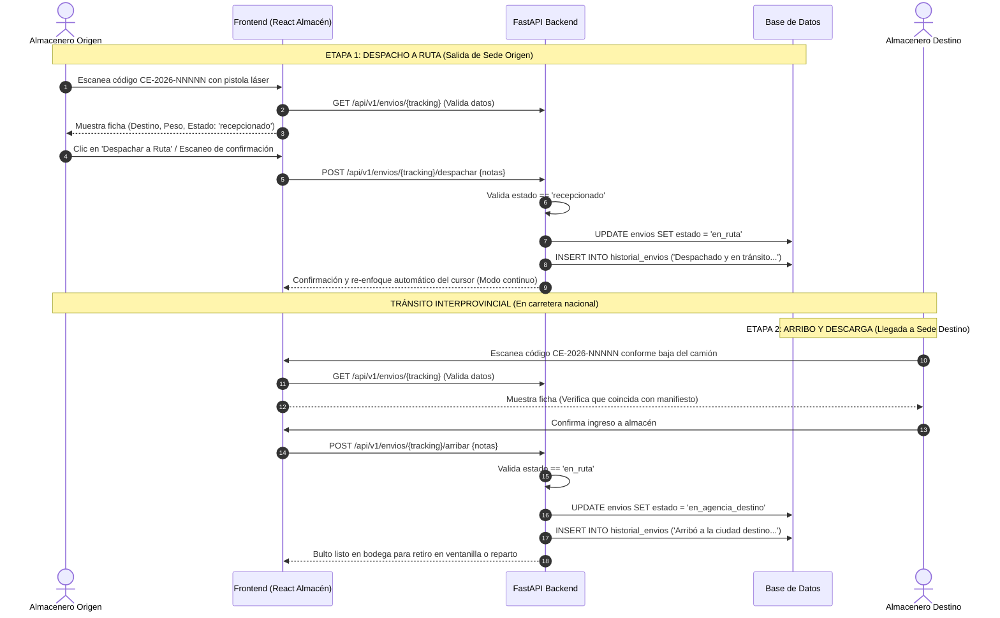

# 🚚 Guía Técnica de Exposición 04: Almacén, Despacho a Ruta y Arribos

Esta guía documenta la operativa física y tecnológica del módulo de **Almacén y Logística de Carga** en **CargaExpress Perú**, abarcando la consolidación de bultos, despacho a camiones de ruta, escaneo láser y recepción de arribos en destino.

---

## 1. Visión General del Negocio y Propósito de Almacén

El módulo de **Almacén** representa la **cadena de custodia física** de las mercancías entre agencias provinciales.

A diferencia del Cajero (que maneja finanzas y atención al cliente en mostrador), el **Operador de Almacén**:
1. **No manipula dinero ni realiza cobros.**
2. Su foco técnico es la **lectura rápida de bultos con pistola láser / lector de código de barras**, la estiba en camiones interprovinciales y la verificación de manifiestos de carga.
3. Garantiza que ningún paquete viaje sin estar formalmente registrado ni ingrese a estanterías sin certificar su arribo físico.

---

## 2. Quiénes Intervienen en el Flujo de Almacén

```text
┌─────────────────────────┐             ┌─────────────────────────┐             ┌─────────────────────────┐
│     1. ALMACENERO       │             │     2. TRANSPORTISTA    │             │     3. ALMACENERO       │
│     SEDE ORIGEN         │             │    (Chofer del Camión)  │             │     SEDE DESTINO        │
│                         │             │                         │             │                         │
│ • Agrupa bultos por     │ ──────────► │ • Recibe carga estibada │ ──────────► │ • Descarga camión con   │
│   ciudad de destino     │             │ • Porta Manifiesto de   │             │   pistola láser         │
│ • Escanea pistola láser │             │   Carga / Guía Remisión │             │ • Cambia estado a       │
│ • Despacha a 'en_ruta'  │             │ • Transporta en ruta MTC│             │   'en_agencia_destino'  │
└─────────────────────────┘             └─────────────────────────┘             └─────────────────────────┘
```

1. **Almacenero Origen:** Custodia los paquetes que entrega el cajero, los clasifica por ciudad de destino, los escanea y formaliza el despacho.
2. **Transportista / Chofer de Camión:** Transporta físicamente la carga por carretera interprovincial con el manifiesto consolidado de viaje.
3. **Almacenero Destino:** Abre la compuerta del camión al arribar a la sede receptora, escanea cada paquete conforme se descarga y los ubica en estanterías para entrega o courier.

---

## 3. Diagrama de Flujo: Despacho y Arribo



---

## 4. Reglas de Negocio Específicas de Bodega

### A. Regla `BR-ENV-02`: Precondición Obligatoria de Despacho
* Un paquete **no puede** ser despachado a ruta si su estado actual en base de datos difiere de `'recepcionado'`.
* Si un operario intenta forzar el despacho de una orden en estado `'registrado'` (que aún no ha sido recibida físicamente en balanza por el cajero), el backend arroja inmediatamente:
  $$\text{HTTP 400 Bad Request: } \text{"El envío se encuentra en estado 'registrado'. Debe estar 'recepcionado' para ser despachado."}$$

### B. Regla `BR-ENV-03`: Precondición Obligatoria de Arribo
* Un paquete **no puede** registrarse como arribado en destino si no se encuentra en estado `'en_ruta'`.
* Esto previene que se registren encomiendas ficticias o duplicadas sin haber registrado el viaje previo.

### C. Modo de Escaneo Láser Rápido en Frontend
* En los almacenes de alto volumen, los operarios usan pistolas lectoras de códigos de barras (emuladores de teclado USB/Bluetooth).
* La interfaz implementa el hook `useRef` con foco automático (`inputRef.current?.focus()`) y selección automática de texto. Al disparar la pistola, el lector transmite el código más un retorno de carro (`Enter`), ejecutando la búsqueda y confirmación sin necesidad de usar el mouse.

---

## 5. Persistencia en Base de Datos y Datos Esenciales

### A. Cambios en la Tabla `envios`

| Momento Operativo | Columna | Valor Anterior | Valor Nuevo |
|:---|:---|:---|:---|
| **Al despachar camión** | `estado` | `'recepcionado'` | `'en_ruta'` |
| | `actualizado_en` | Timestamp recepción | Timestamp UTC despacho |
| **Al descargar en destino** | `estado` | `'en_ruta'` | `'en_agencia_destino'` |
| | `actualizado_en` | Timestamp despacho | Timestamp UTC arribo |

---

### B. Registros en la Tabla `historial_envios`

Cada acción física en almacén deja una huella inmutable en la base de datos:

#### 1. Evento de Despacho:
```json
{
  "envio_id": 3,
  "estado": "en_ruta",
  "descripcion": "Despachado y en tránsito hacia la agencia destino. Notas: Camión Volvo Placa ABC-123 Chofer: Juan Perez.",
  "ubicacion": "Agencia (Origen) ID: 1",
  "usuario_id": 7,
  "creado_en": "2026-10-13T21:05:00Z"
}
```

#### 2. Evento de Arribo:
```json
{
  "envio_id": 3,
  "estado": "en_agencia_destino",
  "descripcion": "Arribó a la ciudad destino y está bajo custodia de la agencia destino. Notas: Recibido en almacén destino con pistola láser.",
  "ubicacion": "Agencia (Destino) ID: 10",
  "usuario_id": 7,
  "creado_en": "2026-10-14T06:30:00Z"
}
```

---

### C. Payloads de Red (API REST)

#### Despachar a Ruta (Frontend $\rightarrow$ Backend):
```json
POST /api/v1/envios/CE-2026-00003/despachar
{
  "notas": "Despachado con pistola láser desde almacén Lima."
}
```

#### Confirmar Arribo en Destino:
```json
POST /api/v1/envios/CE-2026-00003/arribar
{
  "notas": "Recibido en almacén Cusco sin observaciones de daño."
}
```

---

## 6. Módulos de Código Exactos para Mostrar en la Exposición

### Backend:
1. [app/services/envio_service.py](file:///c:/Users/User/Documents/VSC-Integrador/CargaExpressBackend/app/services/envio_service.py):
   * Líneas 80-104: Método `despachar()` (Validación estricta de estado `recepcionado`, cambio a `en_ruta` y registro de hito).
   * Líneas 107-131: Método `arribar()` (Validación de estado `en_ruta`, cambio a `en_agencia_destino` y custodia).
2. [app/api/v1/endpoints/envios.py](file:///c:/Users/User/Documents/VSC-Integrador/CargaExpressBackend/app/api/v1/endpoints/envios.py):
   * Línea 222: Endpoint `/{identificador}/despachar` con control RBAC `require_role(["ADMINISTRADOR", "SUPERVISOR", "ALMACEN", "TRANSPORTISTA"])`.
   * Línea 250: Endpoint `/{identificador}/arribar` con `require_role(["ADMINISTRADOR", "SUPERVISOR", "ALMACEN", "CAJERO"])`.

### Frontend:
1. [src/pages/admin/almacen/AlmacenDespacho.jsx](file:///c:/Users/User/Documents/VSC-Integrador/CargaExpressFront/src/pages/admin/almacen/AlmacenDespacho.jsx):
   * Líneas 14-36: Función `buscarEnvio()` con auto-selección de `inputRef` para pistola lectora.
   * Líneas 38-60: Función `handleDespachar()` y temporizador de limpieza para escaneo continuo.
2. [src/pages/admin/almacen/AlmacenArribos.jsx](file:///c:/Users/User/Documents/VSC-Integrador/CargaExpressFront/src/pages/admin/almacen/AlmacenArribos.jsx):
   * Líneas 14-35: Búsqueda y validación de encomienda en ruta.
   * Líneas 37-58: Función `handleArribar()` para ingreso a estantería de destino.

---

## 7. Preguntas Frecuentes del Jurado y Cómo Defenderlas

| Pregunta Típica | Respuesta Técnica y Logística |
|:---|:---|
| **¿Por qué el operador de almacén no puede realizar cobros en el sistema?** | *"Por el principio de segregación de funciones (SoD - Segregation of Duties) y control antifraude. El almacén solo valida bultos físicos y logística; las transacciones monetarias están restringidas al rol `CAJERO` en el middleware `require_role()`."* |
| **¿Cómo optimizaron la aplicación para escaneo con pistolas de códigos de barras?** | *"Implementamos referencias con `useRef` en React que mantienen el foco activo en el input tras cada escaneo. Al disparar la pistola lectora, el evento se envía automáticamente sin necesidad de tocar el teclado o mouse, logrando tiempos de despacho de menos de 2 segundos por bulto."* |
| **¿Qué sucede si un paquete se extravía o sufre avería en el viaje?** | *"El endpoint `/arribar` recibe el campo `notas`. Si un bulto presenta rotura de embalaje o falta en la descarga del camión, el almacenero ingresa la incidencia, quedando asentada de inmediato en la tabla `historial_envios` para auditoría y reclamos de seguro."* |
