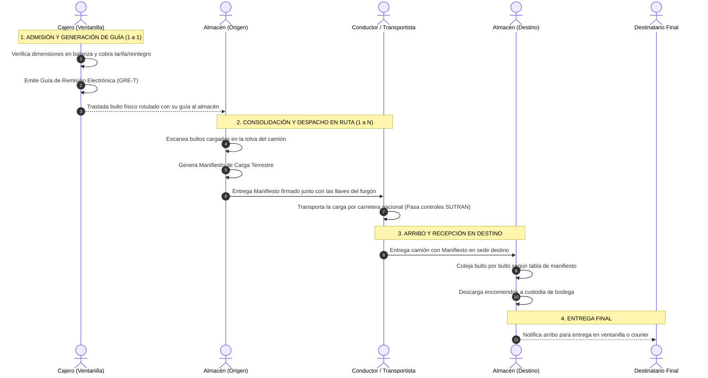

# 🚛 Guía Técnica de Exposición 04: Guías de Remisión Electrónicas (GRE) y Manifiestos de Carga

Esta guía detalla de manera minuciosa, práctica y legal cómo opera el subsistema de **Guías de Remisión Transportista** y **Manifiestos de Carga Terrestre** en **CargaExpress Perú**, cumpliendo con la normativa tributaria y de transporte terrestre nacional.

---

## 1. Marco Legal y Propósito Operativo

En el Perú, el traslado de carga interprovincial está estrictamente fiscalizado por dos entidades gubernamentales:
* **SUNAT (Superintendencia Nacional de Aduanas y de Administración Tributaria):** Exige la **Guía de Remisión Electrónica - Transportista (GRE-T)** bajo la **Resolución de Superintendencia N° 123-2022/SUNAT** para amparar el origen lícito de cada mercadería y evitar el contrabando o evasión tributaria.
* **SUTRAN / MTC (Ministerio de Transportes y Comunicaciones):** Exige el **Manifiesto de Carga Terrestre** (Decreto Supremo N° 017-2009-MTC) en los puestos de pesaje y garitas de peaje para controlar el peso por eje del vehículo, la identidad del conductor y la relación consolidada de los bultos a bordo.

---

## 2. Diferencias Fundamentales: Guía vs Manifiesto

| Atributo | Guía de Remisión Transportista (GRE) | Manifiesto de Carga Terrestre |
| :--- | :--- | :--- |
| **Relación** | **Individual (1 a 1)**: Una guía por cada encomienda registrada. | **Consolidado (1 a N)**: Un manifiesto por cada camión / furgón que viaja. |
| **Ámbito Legal** | Sustenta el traslado legal del bulto específico (`CE-2026-XXXX`). | Sustenta la carga masiva transportada por el vehículo en carretera. |
| **Momento de Emisión** | **En Ventanilla de Caja:** Inmediatamente al admitir, pesar y cobrar el paquete. | **En Almacén de Origen:** Al cerrar el despacho y precintar el camión. |
| **Generación** | **Automática:** Se emite al presionar *"Cobrar / Confirmar y Emitir Guía"*. | **Automática / Consolidada:** Se genera al agrupar los bultos en ruta. |
| **Datos Clave** | • Serie `EG01-XXXXXXXX` • Remitente y Destinatario (DNI/RUC) • Peso en Balanza y Volumen ($L \times A \times H / 6000$) • Flete oficial y comprobante asociado | • Serie `MAN-YYYY-XXXX` • Placa de la unidad (ej. `V8B-942`) y modelo • Chofer responsable y N° Licencia de Conducir • Total de bultos y peso bruto consolidado (kg) |

---

## 3. Flujo Operativo y Actores Involucrados

---

## 4. Estructura de Datos y Persistencia

### A. Guía de Remisión (Tabla `envios`)
La encomienda en base de datos actúa como el soporte digital inmutable de la Guía de Remisión:
* `codigo_tracking`: Identificador alfanumérico único para etiquetas y código de barras.
* `serie_documento` y `numero_documento`: Numeración fiscal SUNAT (`EG01-XXXXXXXX`).
* `peso_kg`: Peso neto comprobado en balanza física de recepción.
* `peso_volumetrico`: Cubicaje comprobado: $(Largo \times Ancho \times Alto) / 6000$.
* `precio_envio`, `monto_subtotal`, `monto_igv`: Desglose tributario oficial con IGV (18%).
* `forma_pago`: Medio verificado en ventanilla (`efectivo`, `yape`, `plin`, `tarjeta`).
* `estado`: Pasa de `'registrado'` a `'recepcionado'` al emitir la guía.

### B. Manifiesto de Carga (Agrupación Consolidada)
* Agrupa todos los envíos con estado `en_ruta`, `en_agencia_destino` o `entregado` para una misma ruta (`agencia_origen_id` $\rightarrow$ `agencia_destino_id`).
* Consolida:
  $$\text{Peso Total del Camión} = \sum_{i=1}^{n} \text{peso\_kg}_i$$
  $$\text{Valor Flete Total} = \sum_{i=1}^{n} \text{precio\_envio}_i$$
* Registra triada de firmas de responsabilidad:
  1. Firma de Salida: Jefe de Almacén Origen (Despachador).
  2. Firma de Custodia: Chofer / Conductor (Transportista en ruta).
  3. Firma de Arribo: Jefe de Almacén Destino (Receptor).

---

## 5. Implementación en Código

### Frontend:
1. [src/components/common/ModalGuiaRemision.jsx](file:///c:/Users/User/Documents/VSC-Integrador/CargaExpressFront/src/components/common/ModalGuiaRemision.jsx):
   * Plantilla visual e imprimible de la **Guía de Remisión Electrónica - Transportista**.
   * **Motor de Impresión Aislado (Iframe Dinámico):** Soluciona el clásico fallo de hojas en blanco de Chromium al imprimir desde modales con scroll (`.modal-dialog-scrollable`). Genera un documento A4 limpio e independiente, preservando la paleta de colores (`-webkit-print-color-adjust: exact`), tabla de bultos, QR oficial SUTRAN y RUC `20100227461`.
2. [src/pages/admin/caja/RecepcionEnvios.jsx](file:///c:/Users/User/Documents/VSC-Integrador/CargaExpressFront/src/pages/admin/caja/RecepcionEnvios.jsx):
   * Módulo de ventanilla con **recálculo dinámico en vivo en balanza** y panel POS sticky sin scroll vertical.
   * **Validación Reactiva de Dimensiones:** Bloqueo preventivo del botón de cobro si los campos están vacíos o en 0 (Largo, Ancho, Alto mín. 1 cm; Peso > 0 kg), evitando rechazos 422 del servidor.
   * Eliminación definitiva de botones provisionales de testing/reinicio para pruebas limpias de punta a punta.
   * Abre automáticamente la Guía de Remisión al confirmar el cobro y la admisión.
3. [src/pages/admin/guias/GuiasList.jsx](file:///c:/Users/User/Documents/VSC-Integrador/CargaExpressFront/src/pages/admin/guias/GuiasList.jsx):
   * Consola centralizada de todas las guías de remisión emitidas en la empresa con buscador rápido y botón de reimpresión.
4. [src/pages/admin/manifiestos/ManifiestosList.jsx](file:///c:/Users/User/Documents/VSC-Integrador/CargaExpressFront/src/pages/admin/manifiestos/ManifiestosList.jsx):
   * Agrupador de despachos consolidados por ruta y vehículo, con generación de **Manifiesto de Carga Terrestre** imprimible.
   * **Motor de Impresión Aislado (Iframe Dinámico A4 Apaisado):** Incorpora el motor de renderizado mediante `<iframe>` aislado para evitar hojas en blanco en navegadores Chromium al imprimir desde modales con scroll. Configurado en formato apaisado (`@page { size: A4 landscape }`) para visualización completa de todas las columnas (Tracking, Remitente, Destinatario, Carga, Peso, Totales y Bloques de Firmas).
   * **Soporte Atajo de Teclado:** Captura nativa de `Ctrl + P` dentro del modal para invocar el motor de impresión directo sin depender de los controles del navegador.

### Backend:
1. [app/schemas/envio.py](file:///c:/Users/User/Documents/VSC-Integrador/CargaExpressBackend/app/schemas/envio.py):
   * Modelo `RecepcionEnvioRequest` con captura de dimensiones, observaciones y `forma_pago`.
2. [app/services/envio_service.py](file:///c:/Users/User/Documents/VSC-Integrador/CargaExpressBackend/app/services/envio_service.py):
   * Método `recepcionar()`: Recalcula peso liquidable oficial, ajusta montos tributarios, formaliza el pago y sella el hito en `historial_envios`.
3. [app/api/v1/endpoints/envios.py](file:///c:/Users/User/Documents/VSC-Integrador/CargaExpressBackend/app/api/v1/endpoints/envios.py):
   * Endpoint `POST /{identificador}/recepcionar` para emisión de guía en mostrador.
   * Endpoint `POST /{identificador}/despachar` para transición a camión en ruta.
   * Endpoint `POST /{identificador}/arribar` para recepción y descarga de furgón.

