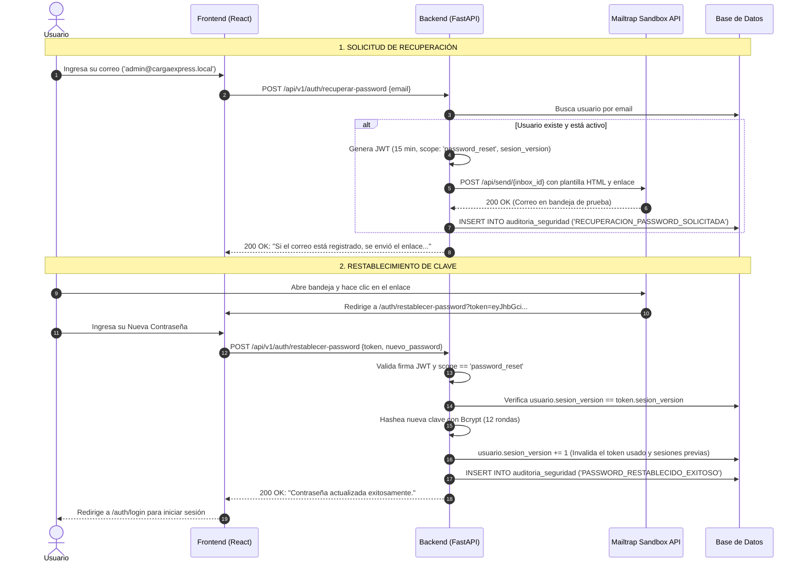

# ✉️ Guía Técnica de Exposición 11: Recuperación de Contraseñas por Email y Mailtrap

Esta guía documenta la arquitectura, el flujo de tokens con tiempo de expiración estricto, la prevención de enumeración de usuarios y la integración de correo mediante **Mailtrap Sandbox API** en **CargaExpress Perú**.

---

## 1. Visión General del Negocio y Seguridad

El flujo de autoservicio de **Recuperación de Contraseñas** permite a cualquier colaborador restaurar el acceso a su cuenta si olvidó su clave, cumpliendo con los estándares de seguridad **OWASP ASVS** (Application Security Verification Standard):

1. **Tokens Efímeros de 15 Minutos:** No se envían contraseñas por correo. Se genera un token criptográfico firmado por JWT con caducidad estricta de 15 minutos y scope exclusivo `password_reset`.
2. **Mitigación de Enumeración de Cuentas:** Si el correo no existe en el sistema, la API responde con el mismo mensaje de éxito genérico para evitar que un atacante descubra qué correos están registrados.
3. **Invalidación de Reutilización:** Cada token incluye el claim `sesion_version`. Al cambiar la contraseña, la versión de sesión se incrementa en base de datos, impidiendo que el enlace sea reutilizado.
4. **Envío Seguro con Mailtrap Sandbox:** Las pruebas y entregas se realizan mediante la API REST de Mailtrap (`https://sandbox.api.mailtrap.io`) sin riesgo de enviar correos accidentales a buzones reales.

---

## 2. Diagrama de Flujo Paso a Paso (Frontend ⇄ Backend ⇄ Mailtrap)



---

## 3. Criptografía y Seguridad del Token de Restablecimiento

En [`app/core/security.py`](file:///c:/Users/User/Documents/VSC-Integrador/CargaExpressBackend/app/core/security.py#L95-L103), el token se construye con parámetros no manipulables:

```python
def create_password_reset_token(user_id: int, sesion_version: int) -> str:
    expires = timedelta(minutes=settings.RESET_TOKEN_EXPIRE_MINUTES) # 15 minutos
    payload = {
        "sub": str(user_id),
        "sesion_version": sesion_version,
        "scope": "password_reset"
    }
    return create_token(payload, expires_delta=expires, scope="password_reset")
```

### Mecanismos de Defensa Criptográfica:
* **Scope Obligatorio:** Si alguien intenta usar este token para autenticarse en endpoints operativos (`/envios`, `/usuarios`), el middleware `get_current_user` lo rechaza porque solo acepta `scope == "access"`.
* **Protección Anti-Replay (Un solo uso):** Cuando la contraseña cambia con éxito, el método `set_password()` incrementa `sesion_version += 1`. Si el usuario hace clic nuevamente en el correo, el token es rechazado con `HTTP 401 Unauthorized`.

---

## 4. Integración con Mailtrap Sandbox API

En [`app/services/email_service.py`](file:///c:/Users/User/Documents/VSC-Integrador/CargaExpressBackend/app/services/email_service.py), el envío se realiza mediante llamadas HTTP REST seguras con Bearer Token:

* **Endpoint de Despacho:** `https://sandbox.api.mailtrap.io/api/send/{settings.MAILTRAP_INBOX_ID}`.
* **Cabecera:** `Authorization: Bearer {settings.MAILTRAP_API_TOKEN}`.
* **Plantilla HTML Responsiva:** Generada en servidor con diseño corporativo CargaExpress, botón de acción directo y advertencia de seguridad indicando el tiempo de expiración.

---

## 5. Persistencia en Base de Datos: Tablas Afectadas

1. **Tabla `usuarios`:**
   * `password_hash`: Se sobrescribe con el nuevo hash Bcrypt de 60 caracteres.
   * `ultimo_cambio_password`: Se actualiza con el timestamp UTC actual.
   * `sesion_version`: Se incrementa en $+1$, cerrando cualquier sesión iniciada previamente en otros dispositivos.
   * `intentos_fallidos`: Se resetea a $0$.
   * `bloqueado_hasta`: Se limpia a `NULL` (desbloquea la cuenta si estaba congelada por intentos fallidos).
2. **Tabla `auditoria_seguridad`:**
   * Registra los eventos inmutables:
     * `RECUPERACION_PASSWORD_SOLICITADA` (con el email de destino y la IP solicitante).
     * `PASSWORD_RESTABLECIDO_EXITOSO` (asentando el éxito de la operación).

---

## 6. Módulos de Código Exactos para Mostrar en la Exposición

### Backend:
1. [app/services/email_service.py](file:///c:/Users/User/Documents/VSC-Integrador/CargaExpressBackend/app/services/email_service.py):
   * Línea 8: `generar_html_recuperacion()` (Plantilla HTML con enlace y caducidad).
   * Línea 112: `enviar_correo_recuperacion()` (Despacho a Mailtrap Sandbox API).
2. [app/services/auth_service.py](file:///c:/Users/User/Documents/VSC-Integrador/CargaExpressBackend/app/services/auth_service.py):
   * Líneas 420-470: `procesar_solicitud_recuperacion()` (Generación del token temporal).
   * Líneas 472-520: `procesar_restablecimiento_password()` (Validación de scope, versión de sesión y hashing).
3. [app/api/v1/endpoints/auth.py](file:///c:/Users/User/Documents/VSC-Integrador/CargaExpressBackend/app/api/v1/endpoints/auth.py):
   * Endpoints `/recuperar-password` y `/restablecer-password`.

### Frontend:
1. [src/pages/auth/RecuperarPassword.jsx](file:///c:/Users/User/Documents/VSC-Integrador/CargaExpressFront/src/pages/auth/RecuperarPassword.jsx):
   * Formulario de ingreso de correo institucional.
2. [src/pages/auth/RestablecerPassword.jsx](file:///c:/Users/User/Documents/VSC-Integrador/CargaExpressFront/src/pages/auth/RestablecerPassword.jsx):
   * Extracción del parámetro `?token=` desde la URL y formulario de nueva contraseña con confirmación.

---

## 7. Preguntas Frecuentes del Jurado / Evaluador y Respuestas

| Pregunta Típica | Respuesta Técnica y de Ciberseguridad |
|:---|:---|
| **¿Por qué la API responde con éxito aunque el correo no exista?** | *"Para mitigar el ataque de Enumeración de Usuarios (OWASP WSTG-IDNT-04). Si respondiéramos 'El correo no existe', un ciberatacante podría automatizar un script para deducir qué personas trabajan en la empresa. La respuesta genérica oculta si la cuenta existe o no."* |
| **¿Qué previene que un token robado sea usado días después?** | *"Dos barreras: la expiración criptográfica fijada en 15 minutos en el payload (`exp`), y el control de versión `sesion_version`. Si la clave ya fue cambiada, el token queda obsoleto al instante."* |
| **¿Por qué usan Mailtrap en el proyecto?** | *"Mailtrap es una plataforma de inspección de correos en entornos de prueba (Sandbox). Nos permite certificar que las plantillas HTML, enlaces dinámicos y cabeceras SMTP/REST funcionan perfectamente sin riesgo de enviar correos no deseados a bandejas reales."* |
