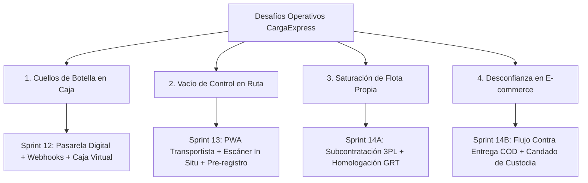

# 15. Planificación Estratégica: Pasarela Digital, App Móvil del Transportista, Flota Tercerizada (3PL) y Pago Contra Entrega (COD)

> **Tipo de Documento:** Especificación Arquitectónica y Planificación de Sprints  
> **Alcance:** Sprints 12, 13 y 14  
> **Propósito:** Brindar el marco técnico, operacional y de negocio para la toma de decisiones sobre las próximas evoluciones críticas de la plataforma CargaExpress Perú.

---

## 1. Visión General de las Mejoras Requeridas

Para escalar la operación de CargaExpress a nivel nacional, se han identificado 4 desafíos operativos clave:



---

## 2. Detalle de Abordaje por Módulo

### 2.1. Pasarela de Pagos Funcional y Automatización del Rol de Caja (Sprint 12)

#### ¿Cuál es el problema actual?
El cajero pierde entre 2 a 4 minutos por cliente cobrando en ventanilla, revisando capturas de Yape/Plin (con riesgo de vouchers falsos) y digitando boletas manuales en el sistema.

#### ¿Cómo se aborda la solución?
1. **Pasarela de Pagos Oficial con Webhooks:**
   * Se integra un proveedor formal (Mercado Pago Perú / Niubiz / Culqi).
   * Al cotizar o registrar online, el cliente genera un enlace seguro de pago o un **QR interoperable dinámico** (Yape / Plin / Tarjeta) con tiempo de expiración (15 minutos).
   * Cuando el cliente paga, la pasarela dispara un **Webhook asíncrono** con firma criptográfica HMAC-SHA256 al backend (`POST /api/v1/pagos/webhook`).
2. **Automatización de Caja:**
   * El sistema crea un registro contable automático en una **Caja Virtual / Pasarela** (ID de caja centralizada).
   * Se emite automáticamente la Boleta/Factura Electrónica y se envía la etiqueta con tracking por email al remitente y destinatario.
   * **Impacto en el cajero:** El cliente solo se acerca a dejar el paquete; el cajero únicamente valida el peso físico en balanza y pega la etiqueta ya pagada, **reduciendo el tiempo de atención a menos de 45 segundos por cliente**.

---

### 2.2. Aplicación Móvil (PWA) para el Transportista: Escaneo In Situ y Confirmación de Pre-Registro (Sprint 13)

#### ¿Cuál es el problema actual?
El transportista (chofer de camión o chofer de recojo local) no tiene una pantalla en su smartphone para confirmar qué encomiendas subió a su tolva ni para atender recojos a domicilio.

#### ¿Cómo se aborda la solución?
1. **PWA (Progressive Web App) en React:**
   * Una vista optimizada para celulares (`/app/transportista`) accesible desde cualquier navegador móvil (Chrome/Safari) con iconos táctiles grandes.
2. **Escaneo con la Cámara del Celular (HTML5 Camera API / QuaggaJS):**
   * El chofer no necesita comprar una pistola lectora láser cara; usa la cámara trasera de su celular.
   * Apunta al QR del paquete al momento de cargarlo: el sistema emite un pitido de confirmación, asocia la encomienda a la placa de su camión y cambia el estado a `EN_TRANSITO` en ese mismo instante.
3. **Confirmación y Conversión de Pre-Registros en Campo:**
   * Cuando un cliente solicita recojo en su domicilio o empresa, el chofer llega, abre el módulo **"Recojo en Puerta"**, escanea el QR del pre-registro que el cliente tiene en su celular o correo.
   * El chofer confirma las medidas y toma una fotografía como evidencia de recepción.
   * En ese milisegundo, el pre-registro se convierte en un `Envio` formal activo, generando su número de tracking definitivo y notificando al cliente por correo.

---

### 2.3. Contingencia ante Agotamiento de la Flota Propia: Flota Tercerizada (3PL) (Sprint 14 - Parte 1)

#### ¿Cuál es el problema actual?
En campañas festivas (Navidad, Cyber Days, Día de la Madre), la flota de camiones propia de CargaExpress se llena al 100% de su capacidad en volumen ($m^3$) y peso (Tn). ¿Qué se hace si no hay camiones disponibles?

#### ¿Cómo se aborda la solución?
1. **Red de Proveedores de Transporte Aliados (3PL):**
   * Se habilita un catálogo de operadores logísticos externos (ej. Civa Cargo, Marvisur, Olva, transportistas locales interprovinciales).
2. **Despacho Tercerizado con Homologación de Guías:**
   * Cuando el jefe de almacén detecta que no hay camiones propios disponibles, selecciona la opción **"Despacho por Flota Tercera"**.
   * Asocia las encomiendas a la empresa externa y registra el **N° de Guía de Remisión del Transportista Externo (GRT)**.
3. **Transparencia para el Cliente vs Control de Costos:**
   * **Para el cliente final:** La experiencia es transparente; sigue rastreando su paquete con el código único de CargaExpress en la web.
   * **Para las Finanzas de la Empresa:** El sistema almacena el costo cobrado por el transportista tercero e impacta directamente en el Data Warehouse (`fact_pnl_rentabilidad_mes`), permitiendo calcular el margen exacto obtenido en encomiendas tercerizadas vs flota propia.

---

### 2.4. Pago Contra Entrega (Cash on Delivery - COD) (Sprint 14 - Parte 2)

#### ¿Qué cosas deben cambiar en el sistema?
El pago contra entrega altera el flujo tradicional porque la mercadería viaja sin estar cancelada:

| Componente | Flujo Tradicional (Prepago) | Flujo Contra Entrega (COD) |
| :--- | :--- | :--- |
| **Estado Inicial de Pago** | `PAGADO` en origen antes de despachar. | `PENDIENTE_PAGO_DESTINO`. |
| **Ventanilla de Destino** | El cliente solo muestra su DNI y retira. | El cajero de destino está **obligado a cobrar** (efectivo o QR) antes de entregar el paquete. |
| **Reparto a Domicilio (Courier)** | El courier solo pide firma y foto de entrega. | La app del courier **bloquea la entrega** hasta que se confirme el medio de pago recibido en puerta. |
| **Caja Móvil de Ruta** | El courier no maneja dinero en ruta. | El courier administra una bolsa de cobros de ruta y al terminar su turno realiza una **rendición de cuentas** en la agencia base. |
| **Protocolo de Rechazo** | Si el cliente no está, se reprograma visita. | Si el cliente destinatario **no tiene el dinero o rechaza la compra**, el paquete pasa a `CUSTODIA_POR_RECHAZO` y se activa el protocolo de retorno a origen con cobro al remitente. |

---

## 3. Matriz de Decisión y Hoja de Ruta

```
┌────────────────────────────────────────────────────────────────────────────────────────┐
│                                 CRONOGRAMA RECOMENDADO                                 │
├─────────────────────────┬──────────────────────────┬───────────────────────────────────┤
│ SPRINT 12               │ SPRINT 13                │ SPRINT 14                         │
├─────────────────────────┼──────────────────────────┼───────────────────────────────────┤
│ • Pasarela Mercado Pago │ • PWA Celular Chofer     │ • Módulo Operadores 3PL           │
│ • Webhooks Seguros      │ • Escáner Cámara QR      │ • Homologación Guías Externas     │
│ • Caja Virtual Automát. │ • Confirmación In Situ   │ • Pago Contra Entrega (COD)       │
│ • Facturación Auto PDF  │ • Pre-registro en Campo  │ • Rendición de Caja Courier Ruta  │
│                         │ • Tracking con GPS       │ • Logística Inversa por Rechazo   │
└─────────────────────────┴──────────────────────────┴───────────────────────────────────┘
```

> [!NOTE]
> Todos los documentos de arquitectura y especificación técnica de cada sprint han sido generados en `docs/sprints/` para servir como base de diseño y sustentación en el informe final.

