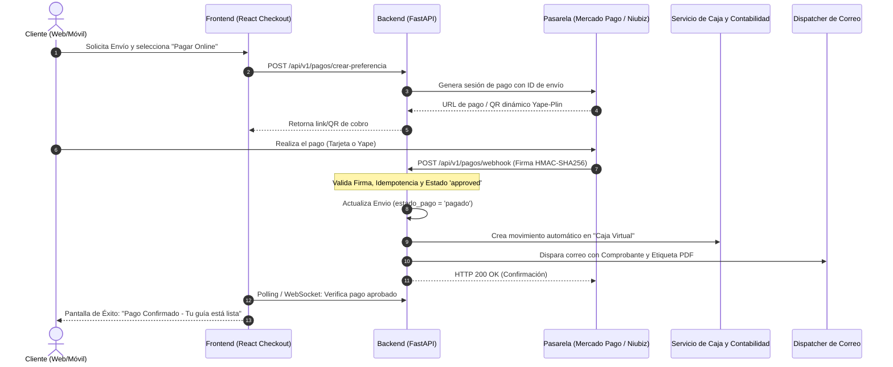

# Sprint 12: Pasarela de Pagos Digitales, Webhooks y Automatización del Rol de Caja

> **Módulos:**
> 1. Integración de Pasarela de Pago Oficial (Mercado Pago / Niubiz / Culqi)
> 2. Webhooks Asíncronos con Criptografía y Control de Idempotencia (`/api/v1/pagos/webhook`)
> 3. Automatización de Caja: Creación de "Caja Virtual / Pasarela" y Asientos Automáticos
> 4. Facturación Electrónica Automática y Notificación Inmediata al Cliente  
> **Frontend:** [CargaExpressFront](file:///c:/Users/User/Documents/VSC-Integrador/CargaExpressFront) (Checkout interactivo, QR dinámico Yape/Plin, visualización de estado de pago en tiempo real)  
> **Backend:** [CargaExpressBackend](file:///c:/Users/User/Documents/VSC-Integrador/CargaExpressBackend) (FastAPI + SQLAlchemy + Pydantic v2 + BackgroundTasks)  
> **Persistencia:** Tablas `transacciones_pasarela`, `movimientos_caja`, `envios`, `comprobantes_pago`  
> **Estado:** 📋 **PLANIFICADO / EN DISEÑO DE ARQUITECTURA**

---

## 1. Justificación y Objetivos de Negocio

Actualmente, el registro de encomiendas y el cobro requieren que el **cajero humano** reciba el dinero físico o valide manualmente la captura de pantalla de Yape/Plin en mostrador, lo cual genera:
1. Cuellos de botella y largas colas de espera en las agencias en horas punta.
2. Riesgo de estafas por comprobantes de pago falsos ("vouchers truchos").
3. Pérdida de tiempo del cajero digitando cada movimiento en el sistema de arqueo.

### Metas del Sprint 12:
* **Autoservicio Digital:** Permitir que los clientes que realizan un pre-registro o cotización online paguen de forma autónoma mediante tarjeta de débito/crédito, PagoEfectivo o QR dinámico interoperable (Yape / Plin).
* **Confirmación Automatizada por Webhook:** Cuando la pasarela procesa el cobro exitosamente, notifica al backend vía HTTP POST cifrado, actualizando el estado del envío a `PAGADO` de forma instantánea.
* **Automatización del Rol del Cajero:**
  * El sistema registra automáticamente un `movimiento_caja` en una cuenta especial denominada **"Caja Pasarela / Virtual"** vinculada a la agencia de origen.
  * Se emite automáticamente la Boleta/Factura Electrónica en PDF y se envía por correo al remitente y destinatario con su número de tracking.
  * El cajero de ventanilla únicamente se encarga de recibir el paquete físico, verificar el peso real en balanza y rotularlo, sin perder tiempo cobrando.

---

## 2. Arquitectura del Flujo de Pagos y Webhooks



---

## 3. Especificación Técnica de Endpoints y Base de Datos

### 3.1. Modelo de Datos (`transacciones_pasarela`)
```sql
CREATE TABLE transacciones_pasarela (
    id SERIAL PRIMARY KEY,
    envio_id INTEGER NOT NULL REFERENCES envios(id),
    pasarela VARCHAR(50) NOT NULL, -- 'mercadopago', 'niubiz', 'culqi'
    transaccion_externa_id VARCHAR(100) UNIQUE NOT NULL, -- ID devuelto por el banco
    monto_cobrado NUMERIC(10, 2) NOT NULL,
    comision_pasarela NUMERIC(10, 2) DEFAULT 0.00,
    monto_neto NUMERIC(10, 2) NOT NULL,
    moneda VARCHAR(5) DEFAULT 'PEN',
    metodo_pago VARCHAR(50), -- 'visa_credit', 'yape', 'pagoefectivo'
    estado VARCHAR(30) NOT NULL, -- 'pending', 'approved', 'rejected', 'refunded'
    payload_webhook JSONB, -- Trazabilidad de auditoría para SUNAT/auditoría
    creado_en TIMESTAMP DEFAULT CURRENT_TIMESTAMP,
    actualizado_en TIMESTAMP DEFAULT CURRENT_TIMESTAMP
);
CREATE INDEX idx_transacciones_envio ON transacciones_pasarela(envio_id);
CREATE INDEX idx_transacciones_externa ON transacciones_pasarela(transaccion_externa_id);
```

### 3.2. Endpoints a Implementar

#### `POST /api/v1/pagos/iniciar-checkout`
* **Acceso:** Público / Clientes autenticados.
* **Payload:** `{ "envio_id": 1234, "metodo_preferido": "yape_o_tarjeta" }`
* **Respuesta:** Enlace de redirección seguro (`init_point`), QR dinámico en Base64 y tiempo de expiración (15 minutos).

#### `POST /api/v1/pagos/webhook`
* **Seguridad (OWASP A08:2021):** Verificación de firma criptográfica en cabecera `x-signature` con `WEBHOOK_SECRET` para evitar suplantaciones de pago.
* **Control de Idempotencia:** Si el webhook se recibe más de una vez (reintentos de la pasarela), el sistema responde `200 OK` sin duplicar los ingresos en caja ni re-emitir boletas.

#### `GET /api/v1/pagos/{envio_id}/estado`
* Permite al frontend consultar el estado de la transacción cada 3 segundos hasta que cambie a `approved`.

---

## 4. Reglas de Negocio (Business Rules)

* **`BR-PAY-01` (Caja Virtual Automática):** Todo pago validado por webhook crea de inmediato un registro en `movimientos_caja` con `tipo = 'ingreso_pasarela'`, `caja_id = 9999` (Caja Virtual Pasarela Centralizada) y referencia cruzada al `transaccion_externa_id`.
* **`BR-PAY-02` (Exclusión del Arqueo Físico):** Los pagos digitales por pasarela se registran en una sub-cuenta contable digital. No alteran el arqueo de billetes físicos que realiza el cajero en ventanilla, evitando descuadres de dinero en mano.
* **`BR-PAY-03` (Tolerancia de Vencimiento):** Los enlaces de pago tienen una vigencia máxima de 15 minutos. Si el usuario no paga en dicho plazo, el pre-registro pasa a `EXPIRADO` para no reservar espacio en bodega innecesariamente.
* **`BR-PAY-04` (Extorno Automático ante Cancelación):** Si el envío pagado por pasarela se anula antes de ser embarcado, el sistema dispara el API de reembolso (`refund`) a la pasarela bancaria y anula el comprobante de pago electrónico.

