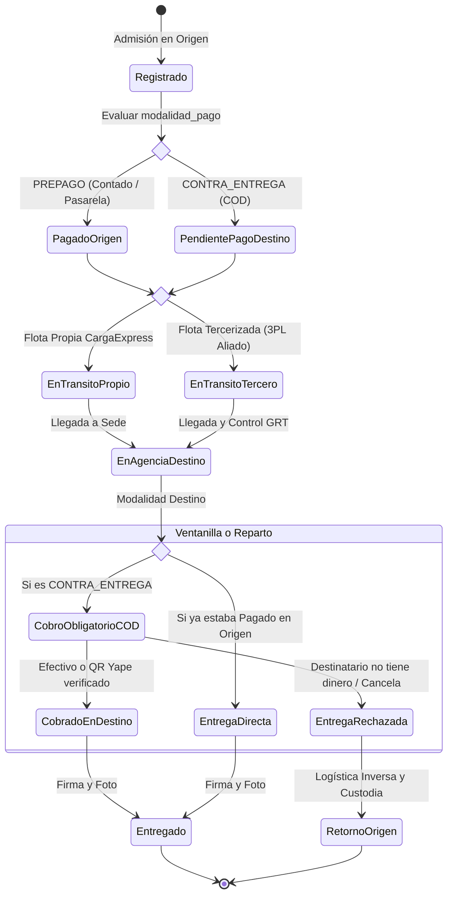

# Sprint 14: Gestión de Flota Tercerizada (3PL) y Modalidad de Pago Contra Entrega (Cash on Delivery - COD)

> **Módulos:**
> 1. Gestión de Operadores Logísticos Tercerizados (3PL) para Picos de Sobredemanda
> 2. Asignación de Despachos a Proveedores Externos y Homologación de Guías de Remisión (GRT)
> 3. Flujo Integral de Pago Contra Entrega (COD) en Ventanilla de Destino y Domicilio
> 4. Rendición de Cuentas de la Caja Móvil de Ruta del Courier
> 5. Protocolo de No Pago, Rechazo de Mercadería y Logística Inversa  
> **Frontend:** [CargaExpressFront](file:///c:/Users/User/Documents/VSC-Integrador/CargaExpressFront) (Asignador de flota 3PL, checkout contra entrega, panel de rendición de valores)  
> **Backend:** [CargaExpressBackend](file:///c:/Users/User/Documents/VSC-Integrador/CargaExpressBackend) (`app/services/flota_tercera_service.py`, `app/services/cod_service.py`)  
> **Persistencia:** Tablas `proveedores_transporte`, `despachos_tercerizados`, `liquidaciones_courier`, `envios`  
> **Estado:** 📋 **PLANIFICADO / EN DISEÑO DE ARQUITECTURA**

---

## 1. Justificación y Objetivos de Negocio

### A. Problemática 1: Agotamiento de la Flota Propia de Camiones (Capacidad 100% Saturada)
Durante temporadas de alta demanda comercial (Navidad, Fiestas Patrias, Cyber Days o campañas agrícolas), el volumen de carga supera la capacidad física de las unidades de transporte propias de CargaExpress.
* **Riesgo:** Si no se gestiona una contingencia, los paquetes quedan varados en el almacén central, violando los Acuerdos de Nivel de Servicio (SLA) y generando quejas.
* **Solución de Arquitectura:** Integrar un módulo de **Transporte Tercerizado (3PL)** que permita derivar manifiestos completos o lotes de encomiendas a empresas de transporte interprovincial aliadas (ej. Civa Cargo, Marvisur, Shalom, Olva Express o transportistas independientes homologados).

### B. Problemática 2: Pago Contra Entrega (Cash on Delivery - COD)
El comercio electrónico en el Perú tiene una alta tasa de desconfianza bancaria; muchos compradores exigen pagar recién cuando el producto llega a sus manos.
* **Riesgo Operativo:** Si el repartidor entrega la encomienda sin cobrar primero, la empresa asume la pérdida económica del flete y del valor de la mercadería.
* **Solución de Arquitectura:** Rediseño del ciclo de vida del envío para que la condición de `PAGADO` sea un prerrequisito obligatorio antes de liberar la custodia física del paquete.

---

## 2. Rediseño del Ciclo de Vida del Envío (Máquina de Estados con COD)



---

## 3. Especificación Técnica: Flota Tercerizada (3PL)

### 3.1. Modelo de Datos (`proveedores_transporte` y `despachos_tercerizados`)
```sql
CREATE TABLE proveedores_transporte (
    id SERIAL PRIMARY KEY,
    ruc VARCHAR(11) UNIQUE NOT NULL,
    razon_social VARCHAR(150) NOT NULL,
    contacto_nombre VARCHAR(100),
    telefono VARCHAR(20),
    correo VARCHAR(100),
    calificacion_sla NUMERIC(3, 2) DEFAULT 5.00,
    activo BOOLEAN DEFAULT TRUE
);

CREATE TABLE despachos_tercerizados (
    id SERIAL PRIMARY KEY,
    proveedor_id INTEGER NOT NULL REFERENCES proveedores_transporte(id),
    guia_remision_tercero VARCHAR(50) NOT NULL, -- N° de guía del transportista aliado
    origen_agencia_id INTEGER NOT NULL REFERENCES agencias(id),
    destino_agencia_id INTEGER NOT NULL REFERENCES agencias(id),
    costo_flete_tercero NUMERIC(10, 2) NOT NULL, -- Costo operacional para la matriz P&L
    fecha_despacho TIMESTAMP NOT NULL,
    fecha_estimada_llegada TIMESTAMP NOT NULL,
    estado VARCHAR(30) DEFAULT 'en_transito', -- 'en_transito', 'arribado', 'con_demora'
    total_bultos INTEGER NOT NULL,
    peso_total_kg NUMERIC(10, 2) NOT NULL
);

-- Relación de encomiendas asignadas al viaje tercerizado
ALTER TABLE envios ADD COLUMN despacho_tercerizado_id INTEGER REFERENCES despachos_tercerizados(id);
```

### 3.2. Impacto en el Data Warehouse y Finanzas (P&L)
Cuando un envío viaja en camión propio, su costo operativo se calcula según amortización de camión, combustible y chofer en planilla.  
Cuando viaja con un **proveedor tercerizado**, el costo exacto cargado en `fact_pnl_rentabilidad_mes` es el `costo_flete_tercero`, permitiendo al Gerente de Operaciones medir si tercerizar esa ruta es más rentable que comprar un camión nuevo.

---

## 4. Especificación Técnica: Pago Contra Entrega (COD)

### 4.1. Modificación de Campos en la Tabla `envios`
```sql
ALTER TABLE envios ADD COLUMN modalidad_cobro VARCHAR(20) DEFAULT 'origen'; 
-- Valores: 'origen' (pagado antes de salir), 'destino' (contra entrega)

ALTER TABLE envios ADD COLUMN valor_mercaderia_recaudar NUMERIC(10, 2) DEFAULT 0.00;
-- Importe del producto para e-commerce (si CargaExpress cobra el producto por cuenta del cliente)

ALTER TABLE envios ADD COLUMN cobrado_por_usuario_id INTEGER REFERENCES usuarios(id);
-- Chofer, Courier o Cajero que tuvo la custodia y cobró el dinero en destino
```

### 4.2. Reglas de Negocio Estrictas (Business Rules)

* **`BR-COD-01` (Candado Lógico de Entrega):** El endpoint `POST /api/v1/envios/{id}/entregar-domicilio` o la entrega en ventanilla rechaza con error `400 BAD REQUEST` si el envío tiene `modalidad_cobro = 'destino'` y no se adjunta el comprobante o referencia de cobro (`medio_pago_destino` y `monto_cobrado_destino`).
* **`BR-COD-02` (Rendición Obligatoria de Courier):** Al final de su jornada, el courier no puede cerrar su sesión ni ser asignado a una nueva ruta hasta que ingrese a la ventanilla de la agencia de destino y rinda el total recaudado en su "Caja Móvil de Ruta", cuadrando el efectivo y las transferencias QR con el cajero principal.
* **`BR-COD-03` (Protocolo de Rechazo y Logística Inversa):** Si el destinatario no dispone del dinero o se niega a recibir el paquete:
  1. El courier registra el incidente con motivo: `"RECHAZADO_FALTA_PAGO"`.
  2. El paquete regresa al almacén de la agencia de destino en estado `EN_CUSTODIA_POR_RECHAZO`.
  3. Se notifica al remitente dándole un plazo de 48 horas para autorizar un segundo reintento o solicitar el retorno a la ciudad de origen (cobrando el flete de retorno según la tarifa de bodegaje).

